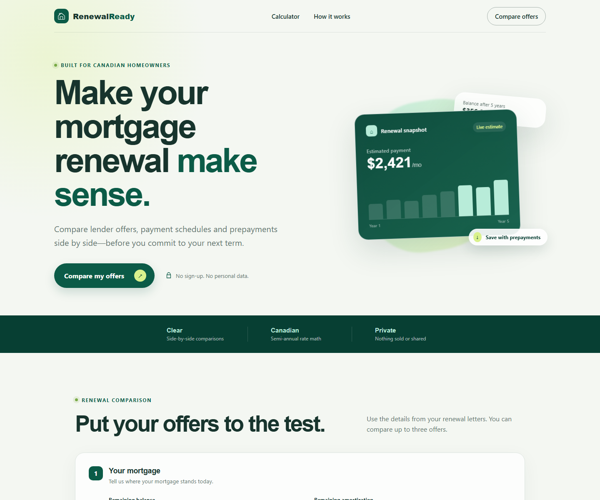

# RenewalReady

RenewalReady is a privacy-first Canadian mortgage renewal comparison tool. A homeowner can compare up to three fixed-rate offers, payment frequencies, renewal-date lump sums and additional payments without creating an account.

This is an independent educational project. It is not affiliated with RBC or any lender and does not provide financial advice.



## What the MVP does

- Compares one to three lender offers side by side
- Supports monthly, biweekly, accelerated biweekly, weekly and accelerated weekly payments
- Simulates every payment through each selected term
- Shows scheduled payment, term interest, principal paid and term-end balance
- Models a lump sum applied at renewal and optional additional payments
- Uses the Canadian fixed-rate convention: nominal annual interest compounded semi-annually, not in advance
- Validates input in both Angular and Spring Boot
- Collects no identity, property address, account number or credit information

## Technology

| Area | Technology |
| --- | --- |
| Client | Angular 20, TypeScript, reactive forms, signals, SCSS |
| API | Java 21, Spring Boot, Bean Validation, Actuator |
| Tests | Jasmine/Karma, JUnit 5, AssertJ, Spring Boot Test |
| Delivery | Docker, Nginx, GitHub Actions, Jenkins |
| Documentation | OpenAPI, architecture notes, ADRs, product validation plan |

## Run locally

### Prerequisites

- Java 21
- Node.js 22 and npm
- Chrome or Chromium for frontend unit tests

Start the API:

```bash
cd backend
./mvnw spring-boot:run
```

In another terminal, start Angular with its API proxy:

```bash
cd frontend
npm ci
npm start
```

Open http://localhost:4200. API health is available at http://localhost:8080/actuator/health.

### Docker Compose

```bash
docker compose up --build
```

Open http://localhost:4200. Nginx serves the Angular build and proxies `/api` to Spring Boot.

## Example API request

```bash
curl -X POST http://localhost:8080/api/v1/mortgage-comparisons \
  -H 'Content-Type: application/json' \
  -d '{
    "principal": 425000,
    "remainingAmortizationMonths": 264,
    "offers": [
      {
        "name": "Current lender",
        "annualInterestRate": 4.79,
        "termMonths": 60,
        "paymentFrequency": "MONTHLY",
        "lumpSumPayment": 0,
        "additionalPaymentPerPeriod": 0
      },
      {
        "name": "Alternative lender",
        "annualInterestRate": 4.49,
        "termMonths": 60,
        "paymentFrequency": "ACCELERATED_BIWEEKLY",
        "lumpSumPayment": 5000,
        "additionalPaymentPerPeriod": 50
      }
    ]
  }'
```

The complete contract is in [`docs/api/openapi.yaml`](docs/api/openapi.yaml).

## Verify the project

```bash
cd backend
./mvnw verify

cd ../frontend
npm ci
npm run build
npm run test:ci
```

GitHub Actions executes these checks for pushes and pull requests. The root [`Jenkinsfile`](Jenkinsfile) demonstrates an equivalent multistage Jenkins pipeline.

## Calculation boundaries

RenewalReady currently models fixed-rate mortgages. It does not model variable-payment triggers, lender-specific compounding, penalties, fees, cashback, tax effects or contractual prepayment limits. A renewal-date lump sum is deducted before recalculating the scheduled payment. Actual lenders may handle this differently.

Currency balances and payment schedules use Java `BigDecimal`; the conversion from a nominal semi-annual rate to a periodic rate uses a fractional exponent and is retained at twelve decimal places. Each simulated payment's interest is rounded to cents using half-even rounding.

Always confirm results and prepayment privileges with the lender or a qualified mortgage professional.

## Repository layout

```text
.
├── backend/                    # Spring Boot comparison API
├── frontend/                   # Angular application and Nginx config
├── docs/
│   ├── adr/                    # Architecture decision records
│   ├── api/                    # OpenAPI contract
│   ├── architecture/           # System context
│   └── product/                # User-validation plan
├── .github/workflows/ci.yml
├── docker-compose.yml
└── Jenkinsfile
```

## Roadmap

1. Validate terminology and results with homeowners and licensed mortgage professionals.
2. Add contract tests generated from the OpenAPI description.
3. Add accessible PDF comparison exports.
4. Add optional local-only saved scenarios.
5. Integrate Bank of Canada rate context without presenting it as a lender quote.
6. Add a demonstration mortgage-servicing workflow and legacy XML adapter.

See [`docs/product/validation-plan.md`](docs/product/validation-plan.md) for measurable validation targets.

## Related open-source financial projects

These projects are useful references and potential contribution targets; RenewalReady does not copy their code:

- [Apache Fineract](https://github.com/apache/fineract) — Apache-licensed core banking and lending platform
- [Mifos X Web App](https://github.com/openMF/web-app) — Angular interface for Fineract
- [Mortgage Expense Calculator](https://github.com/ofcyln/mortgage-expense-calculator) — MIT-licensed Angular mortgage expense PWA for the Netherlands

## Contributing and license

See [`CONTRIBUTING.md`](CONTRIBUTING.md). RenewalReady is available under the [MIT License](LICENSE).
