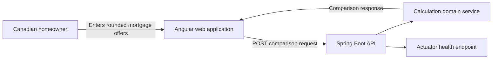

# System context

## Current boundaries

- The application has no database and no authentication in the MVP.
- The browser sends only the financial inputs required for a comparison.
- The API validates transport constraints and business rules before calculating.
- Currency values are represented with `BigDecimal`; payment schedules are simulated payment by payment.
- Fixed rates use the Canadian nominal annual rate compounded semi-annually convention.

## Deployment

Nginx serves the Angular production build and proxies `/api` to the Spring Boot container. Both services can be started with Docker Compose. GitHub Actions and Jenkins definitions verify both applications.
